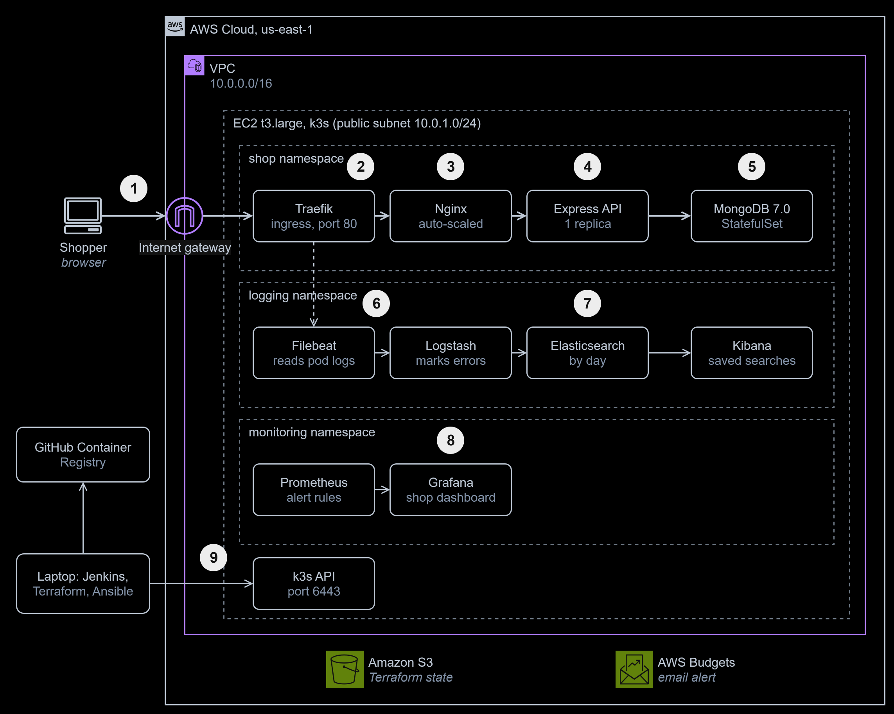
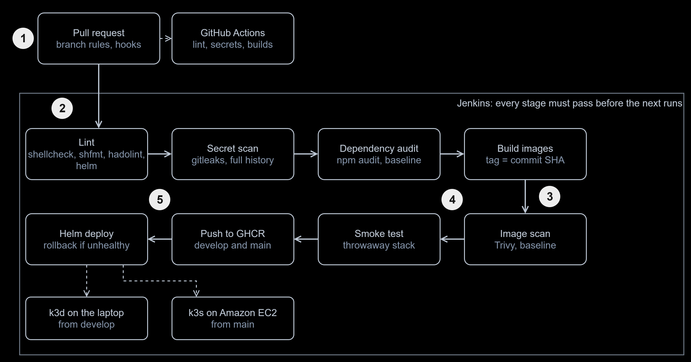

# AI-Powered E-Commerce DevOps Platform

**Type:** internship capstone, lab scale | **Status:** complete, milestones M0 to M8 released as [v1.0.0](https://github.com/ooseni/ai-ecommerce-devops/releases/tag/v1.0.0) | **Live demo:** none, AWS is destroyed when idle to save cost

[](https://github.com/ooseni/ai-ecommerce-devops/actions/workflows/ci.yml)

> **Evaluation project.** The shop's sample catalogue is synthetic, it takes no real payments or customer data, and it is not a production deployment.

**At a glance**

- **Outcome:** a change to an online shop goes from a pull request, through security checks, onto Kubernetes on AWS with no manual step. The running shop is monitored, its logs are searchable, and a tool explains what broke.
- **Built:** a 10-stage [Jenkins pipeline](Jenkinsfile), a [Helm chart](helm/ecommerce), [Terraform](terraform) and [Ansible](ansible) for AWS, [dashboards, alerts and a log pipeline](observability), an [incident analyzer](ai/incident_analyzer.py), and [25 architecture decision records](docs/adr/README.md).
- **Stack:** Jenkins, GitHub Actions, Docker, Nginx, Kubernetes (k3s, k3d), Helm, Terraform, Ansible, AWS (VPC, EC2, S3, Budgets), Prometheus, Grafana, Elasticsearch, Logstash, Filebeat, Kibana, gitleaks, Trivy, Bash, Python.
- **Proof:** on 1 November 2026 a merge into `main` passed every gate and deployed to AWS. I then destroyed AWS and rebuilt it from code, with the shop working 248 seconds after Terraform finished. A rolling restart answered 116 of 116 requests with 200, and the analyzer named the cause of an outage I injected.



To zoom in, right-click the diagram and open the image in a new tab. The editable source is [`docs/diagrams/readme-architecture.drawio`](docs/diagrams/readme-architecture.drawio).

1. A **shopper** reaches the node's fixed address on port 80, the only port open to everyone.
2. **Traefik**, the ingress built into k3s, routes every path to Nginx.
3. **Nginx** serves the React build and forwards `/api` and `/socket.io` to the API.
4. The **Express API** runs as a non-root user with a read-only filesystem.
5. **MongoDB** accepts connections only from pods labelled for it, enforced by a NetworkPolicy.
6. **Filebeat** reads every shop pod's log from the node.
7. **Logstash** marks errors, **Elasticsearch** stores them by day, and **Kibana** searches them.
8. **Prometheus** scrapes nodes, pods and Traefik and evaluates alert rules, and **Grafana** shows the dashboard.
9. My **laptop** runs Jenkins, Terraform and Ansible. SSH and the Kubernetes API answer my ISP's address range only.

## How it works

The shop itself is [mern-ecommerce](https://github.com/mohamedsamara/mern-ecommerce), an open-source React, Express and MongoDB app. I did not write it. What I built is everything that delivers and runs it.



To zoom in, right-click the diagram and open the image in a new tab. The editable source is [`docs/diagrams/readme-pipeline.drawio`](docs/diagrams/readme-pipeline.drawio).

1. A **pull request** is the only way into `develop` and `main`. Hooks scan each commit for secrets first, and **GitHub Actions** checks each pull request.
2. **Jenkins** finds the change within 2 minutes, then lints, scans the git history for secrets and audits the packages.
3. It **builds** both images, tagged with the commit SHA, and **scans** them with Trivy.
4. The **smoke test** runs those exact images in a throwaway stack, which is always removed.
5. From `develop` and `main`, the images go to **GHCR** and **Helm** deploys them: `develop` to k3d on my laptop, `main` to k3s on EC2. A release that stays unhealthy rolls back by itself, and a final check tests the running shop.

More diagrams are in the [decision record](docs/adr/README.md): network, inbound and outbound traffic, request and incident sequences, environments, and the rebuild.

## How it is tested

**On every pull request** (the [`CI`](.github/workflows/ci.yml) workflow): ShellCheck on 14 scripts, hadolint on 3 Dockerfiles, gitleaks over the full history, 10 analyzer unit tests, and both image builds.

**On every branch in Jenkins**, which runs on my laptop, so only while it is on: the lint, secret, audit and image gates, then a smoke test of the 3-container stack. `main` build #2 on 1 November 2026 passed all 8 of its stages and deployed to EC2.

**A failed gate really stops the build.** I lowered one baseline on purpose: `FAIL npm_server: 11 critical, baseline 10`, and every later stage was [skipped](docs/evidence/m3-red-build.jpg).

**Against the live deployment, 1 November 2026:**

- **Rebuild:** 10 resources destroyed, 0 instances and VPCs left, 10 added at a new address. Ansible finished with `ok=23 changed=14 unreachable=0`, and all 3 smoke checks passed [248 seconds later](docs/evidence/m5-rebuild-proof.txt).
- **Rolling restart:** [116 of 116, then 134 of 134](docs/evidence/m4-rolling-update.png) requests answered 200. With the API truly gone, the same check reported 14 of 28 at 502 and failed, so it can fail.
- **Injected outage:** with MongoDB scaled to zero, the smoke test failed 2 of 3 checks, `ShopDatabaseDown` was firing within 100 seconds, and the analyzer [reported MongoDB](docs/evidence/m7-incident-report.md) as the likely cause. After recovery all 3 checks passed within 8 seconds, with no API restart.
- **Blue-green:** release, rollback and clean-up [all passed](docs/evidence/m7-blue-green.txt).

Everything was destroyed afterwards. The full record is in [docs/testing.md](docs/testing.md), and the screenshots are in [docs/evidence](docs/evidence).

## Mistakes I fixed

All 24 problems, with their diagnosis, are in the [challenges log](docs/challenges-log.md). These taught me the most:

1. **An alert that was always firing.** `or vector(0)` made `ShopDatabaseDown` true at all times, so seeing it fire during the outage drill proved nothing. A screenshot exposed it. I fixed the rule, then proved it both ways: quiet while healthy, firing in an outage, clear after recovery.
2. **A test that passed for the wrong reason.** My zero-downtime check passed with the API scaled to zero, because the terminating pod was still serving for its grace period. I repeated it once the pod had gone, and it failed as it should.
3. **Two API replicas would have broken the chat.** My first chart scaled the API, but the support chat keeps online users in memory. The API now stays at one replica, and the autoscaler is on Nginx, which holds no state.
4. **The API stuck at 503 with MongoDB up.** Mongoose never retries a failed first connection, and Compose's start order had hidden that. An init container now waits for the database.
5. **`127.0.0.1` inside a container.** The API could not reach MongoDB, because that address means the container itself. Services now use each other's names.
6. **A security gate nobody could pass.** Failing on any critical finding would leave the pipeline red for good, and a gate that always fails gets switched off. It now blocks new critical findings and fails on an unreadable report.
7. **An exit code that lied.** I piped a job file into `docker exec` without `-i`, so it wrote an empty file and still exited 0. Jenkins could not load the job.
8. **A health check that could never pass.** It called the `mongo` shell, which MongoDB 7 no longer ships, and `2>/dev/null` hid the error.

## Running it

### Locally

Needs Linux or WSL2 with Docker, Node.js 24, npm and openssl.

```bash
scripts/deploy.sh        # set up, then start MongoDB, the API and the shop; waits until healthy
scripts/health-check.sh  # PASS or FAIL for MongoDB, the API and the shop (exit code 0 or 1)
scripts/backup.sh        # compressed database dump in backups/, newest 7 kept
scripts/cleanup.sh       # stop everything; the data stays in the Docker volume
```

The shop opens at <http://localhost:8080> and the API answers under <http://localhost:3000/api>. To load an admin user and 100 sample products, run `ADMIN_EMAIL=you@example.com ADMIN_PASSWORD='...' scripts/setup.sh` once. How the app is built: [docs/app-analysis.md](docs/app-analysis.md).

### With Docker

Needs Docker with the Compose plugin. Create `application/server/.env` once with `scripts/setup.sh`, and stop the native stack first, because both use port 8080.

```bash
docker compose up -d --build   # MongoDB, then the API, then Nginx, each once the one before is healthy
scripts/smoke-test.sh          # PASS or FAIL for the shop page, the database and the products
docker compose down            # the data stays in the mongo-data volume
```

To load sample data, seed once:

```bash
read -rp 'Admin email: ' ADMIN_EMAIL; read -rsp 'Admin password: ' ADMIN_PASSWORD; echo
docker compose exec -T server node utils/seed.js "$ADMIN_EMAIL" "$ADMIN_PASSWORD"; unset ADMIN_PASSWORD
```

Open the shop at <http://127.0.0.1:8080>. Use `127.0.0.1`, not `localhost`, or the support chat cannot connect ([challenge 10](docs/challenges-log.md)).

### The CI pipeline

```bash
export DOCKER_GID=$(stat -c %g /var/run/docker.sock)
docker compose -f ci/jenkins/compose.yaml up -d --build   # Jenkins on http://127.0.0.1:8081
```

It uses the host's Docker Engine through the mounted socket, which is equivalent to root on the host. That is acceptable for a single-user lab on loopback ([ADR-007](docs/decisions/README.md)).

### On Kubernetes

Needs k3d, kubectl and Helm. The images are public on GHCR, tagged with the commit SHA.

```bash
k3d cluster create mern-dev --image rancher/k3s:v1.36.5-k3s1 --servers 1 --agents 0 \
  --port "127.0.0.1:8088:80@loadbalancer" --api-port 127.0.0.1:6445 --wait
scripts/k8s-deploy.sh dev "$(git rev-parse origin/develop)"  # Helm install; rolls back if unhealthy
scripts/smoke-test.sh http://127.0.0.1:8088                  # PASS or FAIL through the ingress
scripts/rolling-update-check.sh                              # restart under traffic; every request must get a 200
```

For the pipeline to deploy, give Jenkins the cluster's address on the Docker network:

```bash
k3d kubeconfig get mern-dev | sed 's#https://127.0.0.1:6445#https://k3d-mern-dev-serverlb:6443#' |
  docker exec -i jenkins sh -c 'umask 077; mkdir -p ~/.kube; cat > ~/.kube/config'
```

### On AWS

Needs Terraform, Ansible and an AWS login. This creates billable resources (a `t3.large` and an Elastic IP, about US$0.09 an hour), so destroy them when finished.

```bash
terraform -chdir=terraform/bootstrap init && terraform -chdir=terraform/bootstrap apply   # the S3 bucket for state, once
cd terraform
cp terraform.tfvars.example terraform.tfvars                                              # your address range and alert email
terraform init -backend-config=bucket="$(terraform -chdir=bootstrap output -raw bucket)"
terraform plan -out=tfplan && terraform apply tfplan
cd ../ansible
ansible-galaxy collection install -r requirements.yml
ansible-playbook -i "$(terraform -chdir=../terraform output -raw public_ip)," site.yml    # hardening and k3s; safe to run again
cd ..
export KUBECONFIG=~/.kube/ec2-k3s.yaml
scripts/k8s-deploy.sh prod "$(git rev-parse origin/main)"
scripts/smoke-test.sh "http://$(terraform -chdir=terraform output -raw public_ip)"
terraform -chdir=terraform destroy                                                        # when finished
```

### Monitoring and incidents

```bash
scripts/observability-up.sh                                         # Prometheus, Grafana, alert rules and ELK
kubectl -n monitoring port-forward svc/monitoring-grafana 3000:80   # http://localhost:3000/d/mern-shop
kubectl -n logging port-forward svc/kibana 5601                     # http://localhost:5601, search "Application errors"
scripts/collect-incident.sh http://<shop address> | ai/incident_analyzer.py
scripts/blue-green.sh release <commit SHA> http://<shop address>    # try a new Nginx image, with instant rollback
```

Neither interface is published, and the Grafana password is generated into the `grafana-admin` Secret. The analyzer removes secret values from every log line, and exits 1 for a critical or high finding.

## Decisions

The [architecture decision record](docs/adr/README.md) explains why it is built this way: 25 decisions, each with its options, trade-offs and evidence, plus the requirements, network and flow diagrams, risks and costs. The [full pack](https://github.com/ooseni/ai-ecommerce-devops/releases/download/v1.0.0/ai-ecommerce-devops-adr-v1.0.pdf) is a 95-slide PDF. The decisions were recorded after release, from the commits and tests.

## Lab vs production

| Concern | In this project | Before going to production | Well-Architected pillar |
|---|---|---|---|
| HTTPS | HTTP on port 80, no domain | A domain and TLS with cert-manager | Security |
| Network | One public subnet; admin ports open to my ISP's range | Private subnets, a load balancer, and Session Manager instead of SSH | Security |
| Known vulnerabilities | Existing critical findings held at a baseline, not fixed | Upgrade the dependencies and lower the baseline to zero | Security |
| CI access | Jenkins uses the Docker socket, equivalent to root on the host | Short-lived build agents, and a narrower registry token | Security |
| Availability | One node in one zone, so a failure stops the shop until a rebuild | Several nodes across zones | Reliability |
| Database | One MongoDB replica; data is lost when AWS is destroyed | A replica set or managed service, with tested backups | Reliability |
| Graceful stop | The API has no SIGTERM handler, so a pod waits out its 30-second grace period | Handle SIGTERM and finish requests in flight | Reliability |
| Alerts | Four rules that fire, with no notification channel | Route alerts to on-call, with runbooks | Operational Excellence |
| CI uptime | Jenkins stops when my laptop is off | Jenkins on a server | Operational Excellence |
| Scaling | API limited to one replica; no load test | Move chat state to Redis, load test, and set limits from the results | Performance Efficiency |
| Spend | Destroyed when idle, about US$0.20 estimated for about 2 hours | Savings Plans and budget actions for an always-on system | Cost Optimization |
| Footprint | `t3.large` chosen to fit ELK on one node | Size from real metrics, and run logging separately | Sustainability |

**Not done yet:** the analyzer's `--ai` option, which adds an explanation from Claude, has never been run against the live API, because I had no API key. The rule engine does not depend on it.

## What I learned

- **Prove a check can fail.** Several of my checks passed for the wrong reason until I made them fail on purpose.
- **A new environment finds what a local file was hiding.** `BASE_API_URL` and the database start order only broke once they left my laptop.
- **Accept known debt in writing, and block new debt.** A gate that always fails gets switched off.
- **Small pushed commits survive anything.** Long power outages cost me hours, but no work.
- **Read the real value.** A token's real scopes, a clock's real time and an exit code's real meaning were each different from what I assumed.

## Roadmap

- ✅ **M0 Foundation**: toolchain, repository, branch protection, secret scanning, app import
- ✅ **M1 App analysis and Bash**: run the app natively, document it, automation scripts
- ✅ **M2 Containers**: Dockerfiles, Nginx reverse proxy, Docker Compose, smoke test
- ✅ **M3 CI/CD and DevSecOps**: Jenkins pipeline, security scans, images pushed to GHCR
- ✅ **M4 Kubernetes and Helm**: manifests and a Helm chart deployed to a local k3d cluster
- ✅ **M5 Infrastructure as code**: Terraform and Ansible build a k3s server on AWS EC2
- ✅ **M6 Observability**: Prometheus and Grafana metrics, ELK log pipeline
- ✅ **M7 AI incident analysis**: log-driven diagnosis and a blue-green release
- ✅ **M8 Report**: architecture diagrams, documentation, v1.0.0 release
- ⬜ **Next**: TLS, a second node, SIGTERM handling, dependency upgrades, alert routing, and a first real run of `--ai`

## Credits

The e-commerce application in [`application/`](application/) is [mern-ecommerce](https://github.com/mohamedsamara/mern-ecommerce) by Mohamed Samara, vendored at commit `7f73dfb` under its [MIT License](application/LICENSE).

Changed here: four homepage banners were resized to 1920 px wide; the API gained `/api/health` and `/api/health/live` (`server/routes/api/health.js`); and `chalk` moved to `dependencies` in `server/package.json`, because the API loads it at runtime.

## License

Released under the [MIT License](LICENSE). The vendored application keeps its own license (see Credits).
