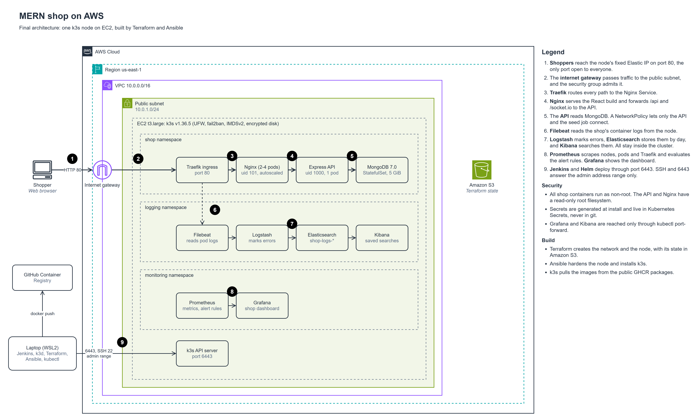
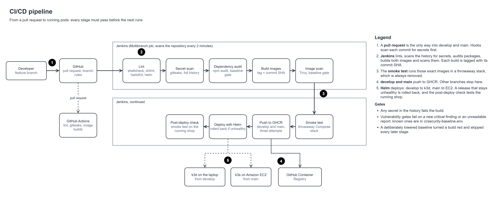

# AI-Powered E-Commerce DevOps Platform

Cloud-native delivery platform for a MERN e-commerce app: CI/CD with Jenkins, Docker, Kubernetes (k3s) and Helm, AWS infrastructure built with Terraform and Ansible, monitoring with Prometheus and Grafana, logging with ELK, DevSecOps scans, and AI-assisted incident analysis.

## The problem

Shipping an online shop by hand is slow and risky: servers are configured manually, releases cause downtime, secrets leak into code, and when something breaks at 2 a.m. nobody knows where to look.

## The solution

One connected pipeline that takes every change from a pull request to a running, monitored deployment:

- **Build and test** on every push (Jenkins, plus a basic GitHub Actions check)
- **Scan** for leaked secrets, vulnerable dependencies and image CVEs (gitleaks, npm audit, Trivy)
- **Package** the app as container images in GitHub Container Registry
- **Provision** AWS infrastructure as code (Terraform) and configure it (Ansible)
- **Deploy** to Kubernetes with Helm, using rolling and blue-green releases
- **Observe** metrics (Prometheus, Grafana) and logs (Elasticsearch, Logstash, Kibana)
- **Diagnose** incidents with an AI tool that reads the error logs

## Architecture





## Run it locally

Needs Linux or WSL2 with Docker, Node.js 24, npm and openssl.

```bash
scripts/deploy.sh        # set up, then start MongoDB, the API and the shop; waits until healthy
scripts/health-check.sh  # PASS or FAIL for MongoDB, the API and the shop (exit code 0 or 1)
scripts/backup.sh        # compressed database dump in backups/, newest 7 kept
scripts/cleanup.sh       # stop everything; the data stays in the Docker volume
```

The shop opens at <http://localhost:8080> and the API answers under <http://localhost:3000/api>.
To load an admin user and 100 sample products, run
`ADMIN_EMAIL=you@example.com ADMIN_PASSWORD='...' scripts/setup.sh` once.
How the app is built: [docs/app-analysis.md](docs/app-analysis.md). Problems met and
fixed along the way: [docs/challenges-log.md](docs/challenges-log.md).

## Run it with Docker

Needs Docker with the Compose plugin. The API reads its settings from
`application/server/.env` when it starts: create that file once with `scripts/setup.sh`,
which also writes a random `JWT_SECRET`. Stop the native stack first with
`scripts/cleanup.sh`, because both use port 8080.

```bash
docker compose up -d --build   # MongoDB, then the API, then Nginx, each once the one before is healthy
scripts/smoke-test.sh          # PASS or FAIL for the shop page, the database and the products (exit 0 or 1)
docker compose down            # stop and remove the containers; the data stays in the mongo-data volume
```

To load an admin user and 100 sample products, seed once:

```bash
read -rp 'Admin email: ' ADMIN_EMAIL; read -rsp 'Admin password: ' ADMIN_PASSWORD; echo
docker compose exec -T server node utils/seed.js "$ADMIN_EMAIL" "$ADMIN_PASSWORD"; unset ADMIN_PASSWORD
```

Open the shop at <http://127.0.0.1:8080>. Use `127.0.0.1`, not `localhost`, or the support
chat cannot connect (challenge 10). Only Nginx is published, and only on this machine;
MongoDB and the API are reachable from the other containers alone.

## CI pipeline

[`Jenkinsfile`](Jenkinsfile) runs on every branch. Jenkins checks the repository every two
minutes, because GitHub's webhooks cannot reach a controller on `127.0.0.1`.

| Stage | What it does | Fails the build when |
|---|---|---|
| Lint | shellcheck, shfmt and hadolint | A script or Dockerfile has a warning or an error |
| Secret scan | gitleaks over the full git history | Any secret is found |
| Dependency audit | `npm audit` on production packages | Critical findings exceed the baseline |
| Build images | Both images, tagged with the commit SHA | A build fails |
| Image scan | Trivy on both images | Critical findings exceed the baseline |
| Smoke test | Runs those images in a throwaway Compose stack, seeds it and runs `smoke-test.sh` | Any check fails |
| Push to GHCR | Publishes both images, from `develop` and `main` only | A push fails after three attempts |
| Deploy to k3d | `helm upgrade` from `develop`, rolled back if the release does not become healthy | The release fails |
| Post-deploy check | `smoke-test.sh` through the cluster's ingress | Any check fails |

The shop's dependencies were pinned upstream years ago, so failing on any critical finding
would leave the pipeline red for good. [`ci/security-baseline.env`](ci/security-baseline.env)
records today's counts instead: a change that adds a critical finding fails, and so does a
scan whose report cannot be read. A basic GitHub Actions workflow also checks every pull request.

To run Jenkins itself, on <http://127.0.0.1:8081>:

```bash
export DOCKER_GID=$(stat -c %g /var/run/docker.sock)
docker compose -f ci/jenkins/compose.yaml up -d --build
```

It uses the host's Docker Engine through the mounted socket, which is equivalent to root on
the host. That is acceptable for a single-user lab on loopback, and production would use
short-lived build agents instead.

## Run it on Kubernetes

Needs k3d, kubectl and Helm. The images are public on GHCR, tagged with the commit SHA.

```bash
k3d cluster create mern-dev --image rancher/k3s:v1.36.5-k3s1 --servers 1 --agents 0 \
  --port "127.0.0.1:8088:80@loadbalancer" --api-port 127.0.0.1:6445 --wait
scripts/k8s-deploy.sh dev "$(git rev-parse origin/develop)"  # Helm install; rolls back if unhealthy
scripts/smoke-test.sh http://127.0.0.1:8088                  # PASS or FAIL through the ingress
scripts/rolling-update-check.sh                              # restart the pods under traffic; every request must get a 200
```

The chart in [`helm/ecommerce`](helm/ecommerce) runs MongoDB as a StatefulSet, and the API and
Nginx as Deployments with probes, resource limits and rolling updates. Every pod runs as
non-root, the API and Nginx on a read-only root filesystem, and only the API may reach MongoDB.
Secrets are generated on the first install and kept on upgrades, so none lives in git.
The API stays at one replica because the support chat keeps online users in memory (challenge
18), and the autoscaler is on Nginx. [`k8s/`](k8s/) holds the same objects as plain manifests.

For the pipeline to deploy, give Jenkins the cluster's address on the Docker network:

```bash
k3d kubeconfig get mern-dev | sed 's#https://127.0.0.1:6445#https://k3d-mern-dev-serverlb:6443#' |
  docker exec -i jenkins sh -c 'umask 077; mkdir -p ~/.kube; cat > ~/.kube/config'
```

## Build it on AWS

Needs Terraform, Ansible and an AWS login. It creates billable resources (a `t3.large` and an Elastic IP, about US$0.09 an hour), so destroy them when finished.

```bash
terraform -chdir=terraform/bootstrap init && terraform -chdir=terraform/bootstrap apply   # the S3 bucket for state, once
cd terraform
cp terraform.tfvars.example terraform.tfvars                                              # your address range and alert email
terraform init -backend-config=bucket="$(terraform -chdir=bootstrap output -raw bucket)"
terraform plan -out=tfplan && terraform apply tfplan
cd ../ansible
ansible-galaxy collection install -r requirements.yml
ansible-playbook -i "$(terraform -chdir=../terraform output -raw public_ip)," site.yml    # hardening and k3s; safe to run again
cd ..
export KUBECONFIG=~/.kube/ec2-k3s.yaml
scripts/k8s-deploy.sh prod "$(git rev-parse origin/main)"
scripts/smoke-test.sh "http://$(terraform -chdir=terraform output -raw public_ip)"
terraform -chdir=terraform destroy                                                        # when finished
```

## Watch it

```bash
scripts/observability-up.sh                                 # Prometheus, Grafana, alert rules and the ELK log pipeline
kubectl -n monitoring port-forward svc/monitoring-grafana 3000:80   # http://localhost:3000/d/mern-shop
kubectl -n logging port-forward svc/kibana 5601             # http://localhost:5601, saved search "Application errors"
```

Neither interface is published. The Grafana password is generated into the `grafana-admin` Secret.

## When something breaks

```bash
scripts/collect-incident.sh http://<shop address> | ai/incident_analyzer.py
```

The analyzer reads health, pod states, events and logs, removes secret values, then reports the likely cause, the evidence and what to do. It exits 1 for a critical or high finding. [Here is its report](docs/evidence/m7-incident-report.md) from a deliberately injected MongoDB outage. With `--ai` and an Anthropic API key, Claude adds a plain-language explanation; that option has not yet been run against the live API.

`scripts/blue-green.sh` releases a new Nginx image beside the old one, tests it, switches the Service, and can switch straight back.

## Roadmap

- ✅ **M0 Foundation**: toolchain, repository, branch protection, secret scanning, app import
- ✅ **M1 App analysis and Bash**: run the app natively, document it, automation scripts
- ✅ **M2 Containers**: Dockerfiles, Nginx reverse proxy, Docker Compose, smoke test
- ✅ **M3 CI/CD and DevSecOps**: Jenkins pipeline, security scans, images pushed to GHCR
- ✅ **M4 Kubernetes and Helm**: manifests and a Helm chart deployed to a local k3d cluster
- ✅ **M5 Infrastructure as code**: Terraform and Ansible build a k3s server on AWS EC2
- ✅ **M6 Observability**: Prometheus and Grafana metrics, ELK log pipeline
- ✅ **M7 AI incident analysis**: log-driven diagnosis and a blue-green release
- ✅ **M8 Report**: architecture diagram, documentation, v1.0.0 release

## Credits

The e-commerce application in [`application/`](application/) is
[mern-ecommerce](https://github.com/mohamedsamara/mern-ecommerce) by Mohamed Samara,
vendored at commit `7f73dfb` under its [MIT License](application/LICENSE).

Changed here: four homepage banners were resized to 1920 px wide; the API gained
`/api/health` and `/api/health/live` (`server/routes/api/health.js`); and `chalk`
moved to `dependencies` in `server/package.json`, because the API loads it at runtime.

## License

Released under the [MIT License](LICENSE). The vendored application keeps its own
license (see Credits).
