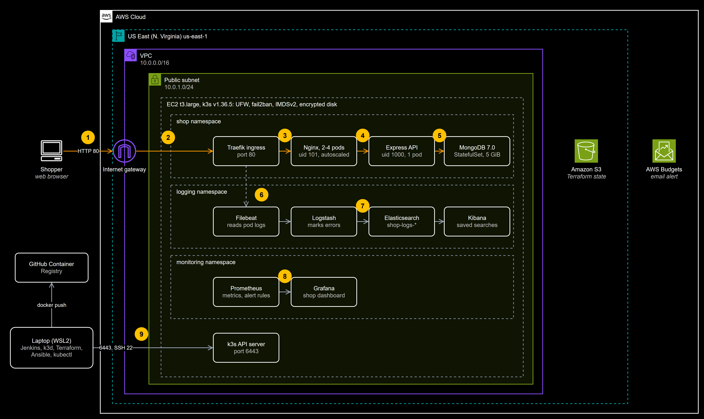

# Architecture decision record

Why this platform is built the way it is: the requirements, the options weighed, the choices, and what each one costs.

| Read it as | Where |
|---|---|
| **Full pack, PDF** (95 slides) | [ai-ecommerce-devops-adr-v1.0.pdf](https://github.com/ooseni/ai-ecommerce-devops/releases/download/v1.0.0/ai-ecommerce-devops-adr-v1.0.pdf) |
| Editable slides | [ai-ecommerce-devops-adr-v1.0.pptx](https://github.com/ooseni/ai-ecommerce-devops/releases/download/v1.0.0/ai-ecommerce-devops-adr-v1.0.pptx) |
| **Each decision, in Markdown** (MADR 4) | [docs/decisions](../decisions/README.md) |
| Editable diagrams | [docs/adr/diagrams](diagrams/) (`.drawio` masters and PNG exports) |

The decisions were recorded after release, from the commits, tests and challenges log, so they describe what was actually built. Every figure comes from a recorded test or the repository; costs are estimates, marked as such. The two pack files are release assets because they exceed the repository's 1 MB file guard.

## The design in one page

To zoom in, right-click the diagram and open the image in a new tab. The editable source is [`diagrams/architecture.drawio`](diagrams/architecture.drawio).

## Requirements

| ID | Area | Measurable requirement |
|---|---|---|
| REQ-01 | Change control | Every change reaches main through a pull request; a secret is blocked before it is committed. |
| REQ-02 | Reproducibility | A fresh clone runs with one command; AWS rebuilds from code with no manual step. |
| REQ-03 | Secure packaging | Images run as non-root, hold no secrets, and pin their base versions. |
| REQ-04 | Gated delivery | Each push is linted, scanned and smoke-tested; a failed gate stops publishing. |
| REQ-05 | Release safety | A rolling update fails 0 requests; an unhealthy release rolls back by itself. |
| REQ-06 | Cost and footprint | AWS stays within US$5-15 in total, and local work fits a 7 GB laptop. |
| REQ-07 | Observability | Dashboards show CPU, memory, pods and requests; errors are searchable; losing the database alerts within 2 minutes. |
| REQ-08 | Diagnosis | A tool names the cause of an injected database outage, with no API key or network needed. |
| REQ-09 | Hardening | Only port 80 is public; SSH is key-only; pods run with least privilege. |
| REQ-10 | Operability | One person can build, run and hand over the whole system from the repository alone. |

## Diagrams

| Diagram | Shows |
|---|---|
| [Starting point](diagrams/as-is-starting-point.png) | The vendored shop before any platform work, with its findings |
| [System architecture](diagrams/architecture.png) | What runs where on AWS |
| [Network](diagrams/network.png) | VPC, routing, security group, UFW and NetworkPolicies |
| [Traffic flow](diagrams/traffic-flow.png) | Inbound and outbound paths, and what allows each hop |
| [Request flow](diagrams/request-sequence.png) | Loading the shop and its products, as a sequence |
| [CI/CD pipeline](diagrams/cicd-pipeline.png) | From a pull request to running pods |
| [Environments](diagrams/environments.png) | The same artefacts on a laptop and on AWS |
| [Observability](diagrams/observability-flow.png) | Metrics, logs and incident data |
| [Incident flow](diagrams/incident-sequence.png) | The injected MongoDB outage, as a sequence |
| [Release strategies](diagrams/release-strategies.png) | Rolling update and blue-green |
| [Provisioning and rebuild](diagrams/provisioning-flow.png) | From an empty account to a working shop |

## Known gaps

The pack states these plainly, and each is tied to a decision or a risk:

- Known critical dependency vulnerabilities are held at a baseline, not fixed ([ADR-009](../decisions/README.md)).
- One node and one API replica mean no high availability ([ADR-013](../decisions/README.md), [ADR-016](../decisions/README.md)).
- The analyzer's `--ai` option has not been run against the live API ([ADR-022](../decisions/README.md)).
- The AWS environment is destroyed when idle, so there is no live demo ([ADR-024](../decisions/README.md)).
